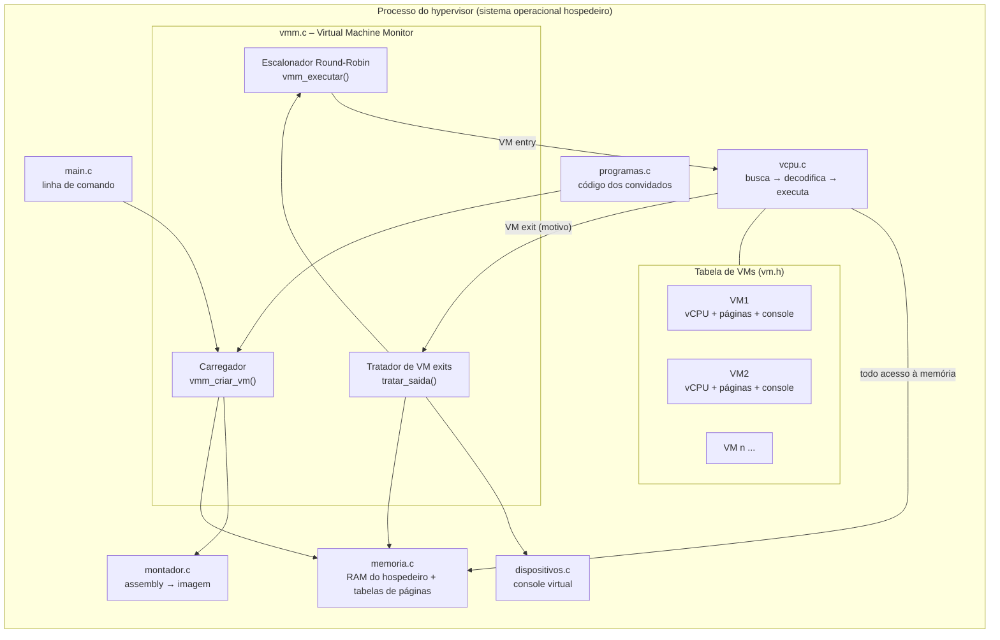
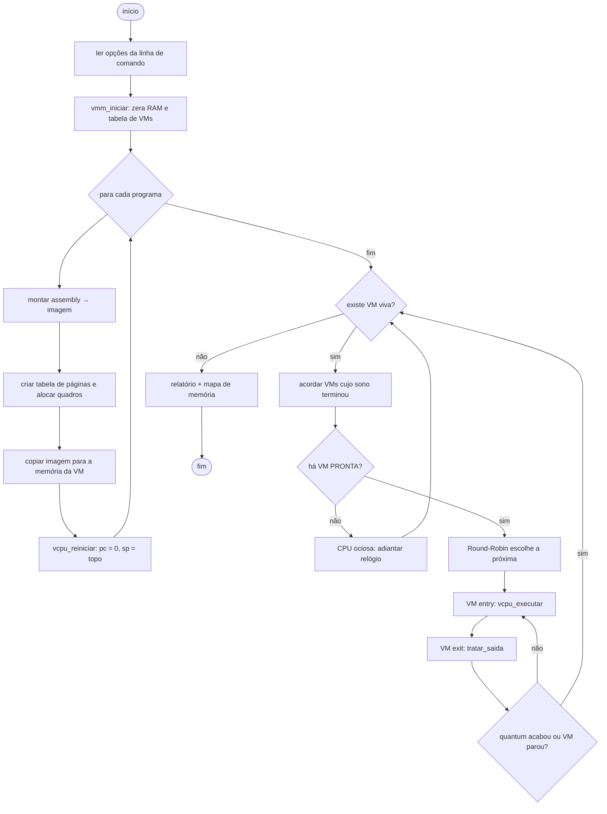

# Etapa 0 – Visão geral e arquitetura

## Objetivo do projeto

O objetivo é construir, do zero e em C, um **hypervisor funcional** que:

1. crie várias **máquinas virtuais (VMs)** isoladas;
2. dê a cada VM uma **CPU virtual**, uma **memória** e um **dispositivo de console** próprios;
3. **compartilhe a CPU real** entre as VMs com preempção;
4. **intercepte** as operações sensíveis dos convidados e as **emule**;
5. **proteja** o hospedeiro e as outras VMs de um convidado malicioso ou defeituoso.

## O que é um VMM (relembrando a aula)

O **VMM (Virtual Machine Monitor)**, também chamado de **hypervisor**, é a camada de software que fica entre o hardware e as máquinas virtuais. Cada sistema convidado (*guest*) acredita ter uma máquina inteira só para si. Na prática, o VMM multiplexa os recursos reais.

Popek & Goldberg (1974) definiram três propriedades para um VMM:

| Propriedade | Significado | Onde está neste projeto |
|---|---|---|
| **Equivalência** | o programa se comporta na VM como numa máquina real | a vCPU executa a ISA completa ([Etapa 3](03-etapa-vcpu.md)) |
| **Controle de recursos** | o VMM controla todos os recursos e o convidado não escapa | tabela de páginas, validação de instruções e watchdog ([Etapas 2](02-etapa-memoria.md), [3](03-etapa-vcpu.md) e [6](06-etapa-escalonador.md)) |
| **Eficiência** | a maioria das instruções roda sem intervenção do VMM | só as instruções *sensíveis* geram VM exit ([Etapa 3](03-etapa-vcpu.md)) |

## Que tipo de hypervisor vamos construir?

Existem três grandes formas de implementar um VMM:

| Técnica | Como funciona | Exemplos |
|---|---|---|
| **Interpretação / emulação** | o VMM lê e executa cada instrução do convidado em software | Bochs, QEMU (modo TCG), **este projeto** |
| **Tradução binária** | o VMM reescreve trechos de código do convidado antes de executar | VMware Workstation (antigo) |
| **Assistida por hardware** | a CPU real executa o convidado e gera *VM exits* nas instruções sensíveis | KVM (Intel VT-x / AMD-V), Hyper-V, Xen HVM |

Este projeto usa **interpretação**. Os motivos são estes:

- **Funciona em qualquer computador:** Linux, Windows ou macOS, em Intel ou ARM. Não precisa de `/dev/kvm`, de permissão de administrador nem de suporte a VT-x.
- **Tudo fica visível:** é possível imprimir cada instrução, cada VM exit e cada tradução de endereço.
- **Mantém a mesma estrutura dos hypervisors reais:** o laço `VM entry → VM exit → tratar → VM entry` é o mesmo do KVM. A [Etapa 9](09-testes-e-exercicios.md) compara os dois lado a lado.

Quanto à classificação vista em aula, este é um **hypervisor do Tipo 2 (hospedado)**: ele roda como um programa comum sobre o sistema operacional hospedeiro.

Como uma CPU x86 real seria grande demais para emular em sala de aula, nossas VMs executam uma **arquitetura didática**: uma CPU simples com 8 registradores e 28 instruções ([Etapa 1](01-etapa-isa.md)). Os conceitos de virtualização são exatamente os mesmos.

## Arquitetura

## Mapa: conceito da aula → código

| Conceito de Sistemas Operacionais | Equivalente no hypervisor | Arquivo |
|---|---|---|
| Processo / PCB | VM / `struct MaquinaVirtual` | `vm.h` |
| Tabela de processos | vetor `vms[MAX_VMS]` | `vmm.c` |
| Contexto de CPU (registradores, PC, SP) | `struct VCpu` | `vcpu.h` |
| Troca de contexto | trocar qual `struct VCpu` a vCPU executa | `vmm.c` |
| Estados (pronto, executando, bloqueado) | `enum EstadoVM` | `vm.h` |
| Escalonamento Round-Robin e quantum | `escolher_proxima()` e `executar_fatia()` | `vmm.c` |
| Interrupção de timer | VM exit `SAIDA_QUANTUM` | `vcpu.c` |
| Modo usuário × modo núcleo | convidado × hypervisor; instruções sensíveis geram trap | `vcpu.c` |
| Trap / exceção | VM exit (`SAIDA_*`) | `vcpu.h` |
| Chamada de sistema | hypercall (`HCALL`) | `vmm.c` |
| Paginação e tabela de páginas | `struct TabelaPaginas` e `memoria_traduzir()` | `memoria.c` |
| Falta de página e paginação sob demanda | `SAIDA_FALTA_PAGINA` e `tratar_falta_pagina()` | `vmm.c` |
| Proteção de memória | `MEMORIA_VIOLACAO`: a VM é abortada | `memoria.c`, `vmm.c` |
| E/S mapeada em portas | instruções `IN`/`OUT` e portas 1 a 4 | `isa.h`, `vmm.c` |
| Driver de dispositivo | `emular_out()`, `emular_in()` e o console | `vmm.c`, `dispositivos.c` |
| Montador, ligador e carregador | `montar()` e `vmm_criar_vm()` | `montador.c`, `vmm.c` |
| CPU ociosa (*idle*) | `ficar_ocioso()` | `vmm.c` |

## Fluxo geral do programa

## Ordem de implementação

As etapas foram ordenadas para que cada uma dependa apenas das anteriores:

1. **ISA:** definir a "máquina" que será virtualizada.
2. **Memória:** a RAM do hospedeiro e a tradução de endereços.
3. **vCPU:** executar instruções e parar nas VM exits.
4. **Dispositivos:** o console que o convidado enxerga.
5. **Montador e programas:** escrever convidados em texto.
6. **Escalonador:** dividir a CPU entre as VMs.
7. **VMM e `main`:** juntar tudo.
8. **Executável e GitHub:** distribuir sem instalação.
9. **Testes e exercícios.**

## Pré-requisitos dos alunos

- C básico: `struct`, vetores, ponteiros para struct, `switch`, `printf` e strings.
- Ter visto em aula: processos, escalonamento, interrupções e traps, paginação e E/S.
- Um compilador C: `gcc` ou `clang` (no Windows, MinGW-w64 ou WSL).

➡️ Próximo passo: [Etapa 1 – A máquina virtual: ISA e registradores](01-etapa-isa.md)
