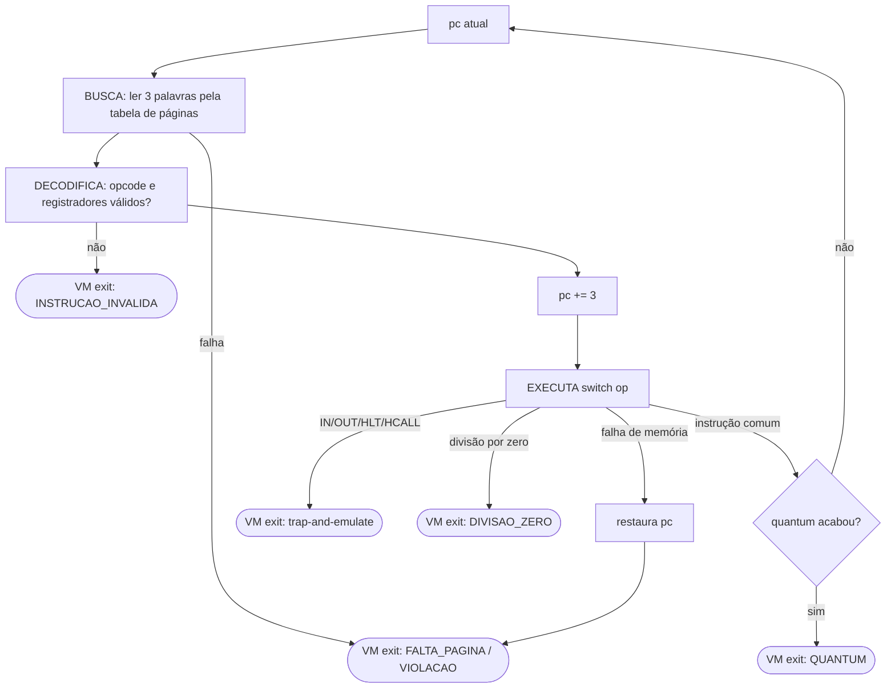

# Etapa 3 – CPU virtual e VM exits

**Arquivos:** `src/vcpu.h`, `src/vcpu.c`, `src/vm.h`, `src/vm.c`

## Objetivo

Construir a **vCPU**: o componente que executa as instruções do convidado e que **para e devolve o controle** ao hypervisor sempre que algo exige a intervenção dele. Esse retorno de controle é a **VM exit**.

## Conceitos da aula aplicados

- O **ciclo de instrução**: busca → decodificação → execução.
- **Traps e exceções**: divisão por zero, acesso inválido à memória, instrução ilegal.
- **Interrupção de timer**: a CPU é retomada ao fim do quantum.
- **Trap-and-emulate**: instruções sensíveis geram trap e o VMM emula o efeito.
- O **contexto** de um processo (registradores, PC, SP) e a troca de contexto.

## Passo 1 – Os motivos de saída (`vcpu.h`)

```c
enum MotivoSaida {
    SAIDA_NENHUMA,             /* uso interno                          */
    SAIDA_QUANTUM,             /* timer: fim da fatia de tempo          */
    SAIDA_IO_OUT,              /* executou OUT                          */
    SAIDA_IO_IN,               /* executou IN                           */
    SAIDA_HLT,                 /* executou HLT                          */
    SAIDA_HYPERCALL,           /* executou HCALL                        */
    SAIDA_FALTA_PAGINA,        /* página válida ainda sem quadro        */
    SAIDA_VIOLACAO_MEMORIA,    /* endereço fora do espaço da VM         */
    SAIDA_INSTRUCAO_INVALIDA,  /* opcode ou registrador inexistente     */
    SAIDA_DIVISAO_ZERO,
    NUM_MOTIVOS_SAIDA
};
```

Essa lista corresponde ao campo `exit_reason` do KVM no Linux (`KVM_EXIT_IO`, `KVM_EXIT_HLT`, `KVM_EXIT_MMIO`, ...).

## Passo 2 – O estado da vCPU (`struct VCpu`)

```c
struct VCpu {
    int reg[NUM_REGISTRADORES];
    int pc, sp, flag;
    long instrucoes_executadas;

    /* detalhes da última VM exit, para o hypervisor */
    int saida_porta;      /* IN/OUT                         */
    int saida_reg;        /* IN/OUT: registrador envolvido  */
    int saida_valor;      /* OUT: valor / HCALL: número     */
    int endereco_falha;   /* faltas de página e violações   */
};
```

> **Troca de contexto de graça.** Todo o estado da CPU de uma VM está nesse struct, e cada VM tem o seu. "Trocar de VM" é só passar outro struct para `vcpu_executar()`, sem copiar nada. Num SO real, a troca de contexto salva os registradores físicos no PCB. No nosso caso eles **já moram** no PCB.

## Passo 3 – O bloco de controle da VM (`vm.h`)

```c
struct MaquinaVirtual {
    int id;
    char nome[MAX_NOME];
    int estado;                    /* enum EstadoVM (Etapa 6)  */
    struct VCpu cpu;               /* CPU virtual              */
    struct TabelaPaginas paginas;  /* memória (Etapa 2)        */
    struct Console console;        /* dispositivo (Etapa 4)    */
    long acordar_em;
    long saidas[NUM_MOTIVOS_SAIDA];/* estatísticas             */
    long fatias;
    char motivo_fim[96];
};
```

É o **PCB do hypervisor**. `vm.c` contém apenas `vm_nome_estado()`, que converte o estado em texto.

## Passo 4 – O laço principal da vCPU

```c
int vcpu_executar(struct MaquinaVirtual *vm, int max_instrucoes, int rastrear)
{
    for (i = 0; i < max_instrucoes; i++) {
        pc = cpu->pc;

        /* 1. BUSCA */
        motivo = buscar(vm, pc, &op, &a, &b);
        if (motivo != SAIDA_NENHUMA)
            return motivo;

        /* 2. DECODIFICA (e valida) */
        if (!instrucao_valida(op, a, b))
            return SAIDA_INSTRUCAO_INVALIDA;

        /* 3. EXECUTA */
        cpu->pc = pc + TAM_INSTRUCAO;
        motivo = executar(vm, op, a, b);

        if (motivo == SAIDA_FALTA_PAGINA || motivo == SAIDA_VIOLACAO_MEMORIA) {
            cpu->pc = pc;            /* instrução será reexecutada */
            return motivo;
        }
        cpu->instrucoes_executadas++;
        if (motivo != SAIDA_NENHUMA)
            return motivo;           /* VM exit */
    }
    return SAIDA_QUANTUM;            /* o "timer" disparou */
}
```



### O "timer"

Um hypervisor real programa um temporizador de hardware. Aqui o parâmetro `max_instrucoes` faz o mesmo papel: depois de N instruções a vCPU **obrigatoriamente** devolve a CPU (`SAIDA_QUANTUM`). Por isso um convidado em laço infinito **não consegue** travar o sistema.

## Passo 5 – Executando as instruções

`executar()` é um único `switch`. Instruções comuns alteram só o `struct VCpu` e a memória da VM:

```c
case OP_ADDI: reg[a] = somar(reg[a], b);  return SAIDA_NENHUMA;
case OP_JEQ:  if (cpu->flag == 0) cpu->pc = a; return SAIDA_NENHUMA;
case OP_LOAD:
    r = ler(vm, b, &valor);               /* passa pela tabela de páginas */
    if (r != SAIDA_NENHUMA) return r;
    reg[a] = valor;
    return SAIDA_NENHUMA;
```

As **instruções sensíveis não fazem nada**. Elas só anotam os detalhes e saem:

```c
case OP_OUT:
    cpu->saida_porta = b;
    cpu->saida_reg = a;
    cpu->saida_valor = reg[a];
    return SAIDA_IO_OUT;     /* o hypervisor é quem vai emular o OUT */
```

Esse é o **trap** do *trap-and-emulate*. A parte do **emulate** fica no hypervisor ([Etapa 7](07-etapa-vmm.md)).

## Passo 6 – Regra de ouro: o convidado não é confiável

Um hypervisor não pode **jamais** travar ou ser corrompido por causa de um convidado. Cada proteção abaixo tem um teste em `tests/testes_unitarios.c`:

| Ataque ou erro do convidado | Risco no hospedeiro | Proteção |
|---|---|---|
| Acessar `mem[3000]` | ler ou escrever memória de outra VM | toda leitura/escrita passa por `memoria_traduzir` |
| Escrever o número 999 na memória e saltar para ele | `switch` com opcode inválido | `instrucao_valida()` testa `0 <= op < NUM_OPCODES` |
| Forjar `MOV R9, R0` na memória | `reg[9]`: escrita fora do vetor, **corrompendo o hospedeiro** | `operando_valido()` testa `0 <= r < 8` |
| `DIV R1, R2` com `R2 = 0` | o processo hospedeiro morre com `SIGFPE` | testa o zero antes e gera `SAIDA_DIVISAO_ZERO` |
| `INT_MIN / -1` | também gera `SIGFPE` em x86 | caso tratado à parte |
| `ADD` com estouro | comportamento indefinido em C | aritmética feita em `unsigned` |

```c
static int somar(int x, int y) { return (int)((unsigned)x + (unsigned)y); }
```

## Passo 7 – Reexecução após falta de página

Quando um `PUSH` acessa uma página de pilha ainda ausente, o hypervisor aloca o quadro e **a mesma instrução é executada de novo**. Para isso funcionar:

1. a vCPU **restaura o `pc`** para o início da instrução;
2. **nenhum estado pode ter mudado** antes da falha.

Por isso, nas instruções de pilha, **a escrita na memória vem primeiro** e só depois o `sp` é alterado:

```c
case OP_PUSH:
    r = escrever(vm, cpu->sp - 1, reg[a]);   /* 1º: pode falhar          */
    if (r != SAIDA_NENHUMA) return r;        /*     sp ainda intacto     */
    cpu->sp--;                               /* 2º: só se deu certo      */
    return SAIDA_NENHUMA;
```

CPUs reais têm a mesma exigência (*instruções reiniciáveis*), e é isso que torna possível a memória virtual sob demanda.

## Ponto de verificação

Com a ISA, a memória e a vCPU prontas, já é possível executar código montado à mão, sem hypervisor:

```c
#include <stdio.h>
#include <string.h>
#include "src/vm.h"
#include "src/isa.h"

int main(void)
{
    static struct MaquinaVirtual vm;
    int programa[] = { OP_LOADI, 0, 6,   OP_LOADI, 1, 7,
                       OP_MUL,   0, 1,   OP_HLT,   0, 0 };
    int i, motivo;

    memoria_iniciar();
    memset(&vm, 0, sizeof vm);
    vm.id = 1;
    memoria_iniciar_tabela(&vm.paginas, 1);
    memoria_alocar_pagina(&vm.paginas, 0, 1);
    for (i = 0; i < 12; i++)
        memoria_escrever(&vm.paginas, i, programa[i]);
    vcpu_reiniciar(&vm.cpu, 0, 64);

    motivo = vcpu_executar(&vm, 100, 1);       /* 1 = rastrear */
    printf("saida=%s R0=%d\n", vcpu_nome_saida(motivo), vm.cpu.reg[0]);
    return 0;                                  /* saida=HLT R0=42 */
}
```

```bash
cc -std=c99 teste_vcpu.c src/isa.c src/memoria.c src/vcpu.c src/vm.c -o /tmp/tv && /tmp/tv
```

> `vm.h` inclui `dispositivos.h`, por causa do tipo `struct Console`. Se estiver seguindo as etapas em ordem, crie antes esse cabeçalho, descrito na [Etapa 4](04-etapa-dispositivos.md). Ele é curto.

## Para discutir em aula

1. Por que a vCPU **não** imprime nada no `OUT`, deixando isso para o hypervisor?
2. Que problema surgiria se o `PUSH` decrementasse `sp` **antes** de escrever?
3. Quanto custa cada VM exit? Compare as colunas `E/S` e `HCALL` do programa `ola` no relatório final (tema da [Etapa 4](04-etapa-dispositivos.md)).

⬅️ [Etapa 2](02-etapa-memoria.md) · ➡️ [Etapa 4 – Dispositivos e hypercalls](04-etapa-dispositivos.md)
