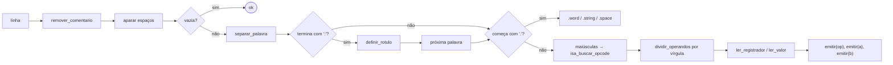

# Etapa 5 – Montador, carregador e programas convidados

**Arquivos:** `src/montador.h`, `src/montador.c`, `src/programas.h`, `src/programas.c`, mais a função `vmm_criar_vm` de `src/vmm.c`

## Objetivo

Escrever programas convidados como **texto legível** (assembly), em vez de vetores de números, e colocá-los na memória de uma VM nova:

```
texto assembly ──montador──> imagem (vetor de int) ──carregador──> memória da VM
```

Tudo acontece **em memória**: o código-fonte dos convidados está embutido no executável como `const char[]`.

## Conceitos da aula aplicados

- **Montador** (*assembler*) e **carregador** (*loader*): como um programa sai do texto e chega à memória.
- **Endereçamento**: rótulos viram endereços absolutos no espaço do convidado.
- **Layout de memória de um processo**: código e dados embaixo, pilha no topo, crescendo para baixo.

## Passo 1 – A linguagem

```asm
; comentário até o fim da linha
rotulo:  INSTRUCAO operando, operando
         .word   1, 2, 3          ; uma palavra por valor
         .string "texto\n"        ; um caractere por palavra + 0 final
         .space  10               ; 10 palavras zeradas
```

Operandos aceitos: `R0`..`R7`, números (`10`, `-3`), caracteres (`'A'`, `'\n'`) e rótulos. A tabela completa está na [referência da ISA](referencia-isa.md).

Exemplo real (programa `contador`):

```asm
        LOADI R0, 1            ; R0 = contador
        LOADI R1, '\n'
laco:   OUT   R0, 1            ; imprime o número
        OUT   R1, 2            ; quebra de linha
        ADDI  R0, 1
        CMPI  R0, 10
        JGT   fim              ; passou de 10? termina
        JMP   laco
fim:    HLT
```

## Passo 2 – Por que dois passos?

No código acima, `JGT fim` usa o rótulo `fim` **antes** de ele ser definido. O montador ainda não sabe o endereço. A solução clássica é ler o texto **duas vezes**:

| Passo | O que faz |
|---|---|
| **1º** | percorre as linhas contando palavras; quando acha `rotulo:`, guarda `(nome, endereço atual)` |
| **2º** | percorre de novo; agora todo rótulo tem endereço, e a imagem é gerada de verdade |

O mesmo código trata os dois passos. A única diferença está em dois lugares:

```c
static int emitir(struct Montador *m, int valor)
{
    ...
    if (m->passo == 2)                 /* no 1º passo só conta */
        m->imagem[m->posicao] = valor;
    m->posicao++;
    return 1;
}

/* em ler_valor(): */
if (m->passo == 1) { *valor = 0; return 1; }   /* rótulo ainda desconhecido */
```

## Passo 3 – Processando uma linha

`montar_linha()` aplica, em ordem, funções simples de string:



Funções usadas: `isspace`, `isalpha`, `isdigit`, `toupper`, `strcmp`, `strlen`, `strcpy`, `strtoll` e `snprintf`. Nada além do que se vê num primeiro curso de C.

Dois detalhes de robustez:

- `;` e `,` **dentro de aspas** não contam (`'.'`, `','`, `"a;b"`). As funções `remover_comentario` e `dividir_operandos` acompanham se estão dentro de aspas.
- Toda mensagem de erro informa **a linha**, por exemplo `linha 3: rotulo nao definido 'fmi'`.

## Passo 4 – O carregador (`vmm_criar_vm`)

```c
int vmm_criar_vm(const char *nome, const char *fonte)
{
    /* 1. monta: texto -> imagem (reserva espaço para a pilha) */
    tamanho = montar(fonte, imagem, MAX_PALAVRAS_VM - TAM_PILHA, erro, sizeof erro);

    /* 2. calcula o espaço da VM: imagem + pilha */
    paginas_imagem = (tamanho + TAM_PAGINA - 1) / TAM_PAGINA;           /* arredonda p/ cima */
    paginas_total  = (tamanho + TAM_PILHA + TAM_PAGINA - 1) / TAM_PAGINA;

    /* 3. preenche o bloco de controle */
    memoria_iniciar_tabela(&vm->paginas, paginas_total);

    /* 4. aloca quadros SÓ para a imagem (pilha fica ausente) */
    for (i = 0; i < paginas_imagem; i++)
        memoria_alocar_pagina(&vm->paginas, i, vm->id);

    /* 5. copia a imagem para a memória da VM */
    for (i = 0; i < tamanho; i++)
        memoria_escrever(&vm->paginas, i, imagem[i]);

    /* 6. "liga" a vCPU */
    vcpu_reiniciar(&vm->cpu, 0, paginas_total * TAM_PAGINA);
    vm->estado = VM_PRONTA;
}
```

Layout resultante do espaço de endereçamento do convidado:

```
endereço 0  ┌──────────────────────────┐  ← pc começa aqui
            │ código                    │
            │ dados (.word, .string)    │
            ├──────────────────────────┤
            │ (livre)                   │
            │          ▲                │
            │          │ pilha cresce   │
 topo       └──────────────────────────┘  ← sp começa aqui (= páginas × 64)
```

O truque `(x + TAM_PAGINA - 1) / TAM_PAGINA` faz a **divisão arredondando para cima** usando só inteiros.

## Passo 5 – Programas embutidos (`programas.c`)

Cada programa é uma string C, e as linhas são concatenadas pelo compilador:

```c
static const char FONTE_CONTADOR[] =
    "        LOADI R0, 1\n"
    "laco:   OUT   R0, 1\n"
    ...;

const struct ProgramaConvidado PROGRAMAS[] = {
    { "contador", "conta de 1 a 10", FONTE_CONTADOR },
    ...
};
```

> Atenção ao escape duplo: dentro de uma string C, o `'\n'` do assembly precisa ser escrito `'\\n'`, e as aspas, `\"`.

| Programa | Demonstra |
|---|---|
| `ola` | `OUT` (trap-and-emulate) × `HCALL` (paravirtualização), `IN` |
| `contador` | compartilhamento da CPU |
| `fatorial` | recursão, pilha, **falta de página sob demanda** |
| `primos` | aritmética, `MOD`, desvios |
| `fibonacci` | variáveis na memória (`LOAD`/`STORE`) |
| `ordena` | Bubble Sort, endereçamento indireto (`LOADR`/`STORER`) |
| `dorminhoco` | estado **BLOQUEADA** (`HCALL 2`), relógio virtual |
| `invasor` | **isolamento**: acesso fora da memória |
| `divzero` | exceção de divisão por zero |
| `guloso` | laço infinito: **preempção** e **watchdog** |

### Como adicionar um programa novo

1. Escreva o assembly como `static const char FONTE_MEU[] = "...";` em `programas.c`.
2. Adicione `{ "meu", "descrição", FONTE_MEU },` ao vetor `PROGRAMAS`.
3. Recompile e execute: `make && ./build/hypervisor meu`.

Se houver erro de sintaxe, o hypervisor avisa e não cria a VM:

```
[VMM] ERRO ao montar 'meu': linha 4: instrucao desconhecida 'ADDD'
```

## Ponto de verificação

```c
#include <stdio.h>
#include "src/montador.h"

int main(void)
{
    int imagem[64], i, n;
    char erro[120];

    n = montar("inicio: LOADI R0, 7\n JMP inicio\n", imagem, 64, erro, sizeof erro);
    for (i = 0; i < n; i++)
        printf("%d ", imagem[i]);      /* 1 0 7 15 0 0 */
    printf("\n");
    return 0;
}
```

```bash
cc -std=c99 teste_montador.c src/montador.c src/isa.c -o /tmp/tm && /tmp/tm
```

Depois do projeto completo, os 15 testes da seção **Montador** de `make test` cobrem esta etapa. Também é possível ver o fonte de qualquer programa com `./build/hypervisor -s nome`.

## Para discutir em aula

1. Em que um **ligador** (*linker*) seria diferente deste montador?
2. Por que a imagem começa no endereço 0 de **todas** as VMs sem conflito? (Volte à [Etapa 2](02-etapa-memoria.md).)
3. O que aconteceria numa recursão infinita? A pilha invadiria o código. Como uma **página de guarda** resolveria isso?

⬅️ [Etapa 4](04-etapa-dispositivos.md) · ➡️ [Etapa 6 – Escalonador de VMs](06-etapa-escalonador.md)
