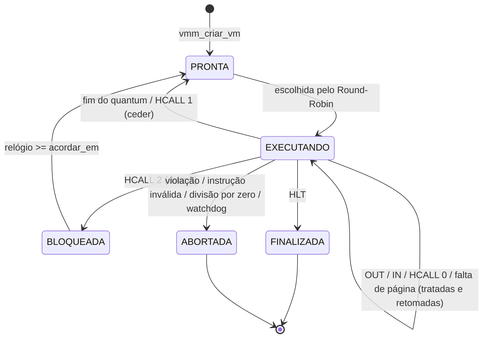

# Etapa 6 – Escalonador de VMs

**Arquivo:** `src/vmm.c` (funções `executar_fatia`, `escolher_proxima`, `acordar_vms`, `ficar_ocioso` e `vmm_executar`)

## Objetivo

Existe **uma** CPU real e **várias** vCPUs. O hypervisor precisa dividir o tempo da CPU entre elas de forma justa, sem deixar que uma VM monopolize o processador. É exatamente o problema de **escalonamento de processos**, agora aplicado a máquinas inteiras.

## Conceitos da aula aplicados

- **Estados** e o diagrama de transições.
- **Round-Robin** com **quantum** e **preempção** por timer.
- **Troca de contexto**.
- **Bloqueio** e **desbloqueio** (sono).
- **Processo ocioso** (*idle*).
- **Watchdog** e limite de recursos.

## Passo 1 – Os estados de uma VM

```c
enum EstadoVM { VM_LIVRE, VM_PRONTA, VM_EXECUTANDO, VM_BLOQUEADA,
                VM_FINALIZADA, VM_ABORTADA };
```



É o mesmo diagrama de estados de processos visto em aula.

## Passo 2 – O relógio do hypervisor

```c
static long relogio;   /* tempo global, em instruções executadas ("ticks") */
```

O relógio avança a cada instrução executada por **qualquer** VM. Ele serve para três coisas:

- marcar o tempo nas mensagens (`[VMM] t=52 ...`);
- decidir quando uma VM BLOQUEADA deve acordar;
- responder ao `IN R, 4` dos convidados.

Usar instruções como unidade de tempo deixa a execução **determinística**: a saída é sempre igual, o que facilita a correção de trabalhos e os testes automáticos.

## Passo 3 – Uma fatia de tempo (`executar_fatia`)

```c
static void executar_fatia(struct MaquinaVirtual *vm)
{
    int restante = config.quantum;

    vm->estado = VM_EXECUTANDO;
    vm->fatias++;

    while (vm->estado == VM_EXECUTANDO) {
        long antes = vm->cpu.instrucoes_executadas;
        ...
        motivo = vcpu_executar(vm, maximo, config.rastrear);   /* VM entry */

        relogio  += vm->cpu.instrucoes_executadas - antes;
        restante -= vm->cpu.instrucoes_executadas - antes;

        tratar_saida(vm, motivo);                              /* VM exit  */

        /* watchdog */
        if (vm_viva(vm) && vm->cpu.instrucoes_executadas >= config.limite_instrucoes)
            encerrar_vm(vm, VM_ABORTADA, "watchdog: ...");

        if (vm->estado == VM_EXECUTANDO && restante <= 0)
            vm->estado = VM_PRONTA;                            /* preempção */
    }
}
```

O ponto central é este: **várias VM exits podem acontecer dentro de uma mesma fatia**. Um `OUT`, por exemplo, sai da VM, é emulado e a VM **continua** de onde parou, consumindo o que resta do quantum. A fatia só termina quando:

| Situação | Novo estado |
|---|---|
| quantum esgotado (`SAIDA_QUANTUM`) | PRONTA |
| `HCALL 1` (ceder) | PRONTA |
| `HCALL 2` (dormir) | BLOQUEADA |
| `HLT` | FINALIZADA |
| erro ou watchdog | ABORTADA |

## Passo 4 – Round-Robin (`escolher_proxima`)

```c
static int escolher_proxima(int atual)
{
    for (k = 1; k <= num_vms; k++) {
        i = (atual + k) % num_vms;       /* anda em círculo pela tabela */
        if (vms[i].estado == VM_PRONTA)
            return i;
    }
    return -1;                           /* ninguém pronto */
}
```

O operador `%` transforma o vetor numa **fila circular**: depois da última VM vem a primeira. Começar em `atual + 1` garante que a VM que acabou de rodar vá para o **fim da fila**. Ela só roda de novo seguida se for a única pronta (quando `k == num_vms`, `i == atual`).

## Passo 5 – Sono e CPU ociosa

```c
static void acordar_vms(void)          /* BLOQUEADA -> PRONTA */
{
    for (i = 0; i < num_vms; i++)
        if (vms[i].estado == VM_BLOQUEADA && relogio >= vms[i].acordar_em)
            vms[i].estado = VM_PRONTA;
}
```

Se **todas** as VMs vivas estiverem dormindo, não há nada para executar. Um SO real executaria o processo *idle* (instrução `HLT` da CPU). Aqui o hypervisor **adianta o relógio** até a primeira VM acordar e contabiliza esse intervalo como `tempo_ocioso`:

```c
static void ficar_ocioso(void)
{
    /* encontra o menor acordar_em entre as BLOQUEADAS */
    ...
    tempo_ocioso += menor - relogio;
    relogio = menor;
}
```

Teste com `./build/hypervisor -v dorminhoco`: só há uma VM, e ela passa a maior parte do tempo dormindo.

## Passo 6 – O laço do escalonador (`vmm_executar`)

```c
void vmm_executar(void)
{
    int atual = -1, proxima;

    while (existe_vm_viva()) {
        acordar_vms();
        proxima = escolher_proxima(atual);

        if (proxima < 0) {          /* todas dormindo */
            ficar_ocioso();
            continue;
        }
        if (proxima != atual)
            trocas_contexto++;      /* trocou de VM */
        atual = proxima;
        executar_fatia(&vms[atual]);
    }
}
```

## Passo 7 – Watchdog

A preempção impede que o programa `guloso` **trave as outras VMs**, mas ele continuaria rodando para sempre. O **watchdog** limita o total de instruções por VM (`-m N`, padrão 100000). Ao atingir o limite, a VM é abortada:

```
[VMM] t=100958 VM6 (guloso) ABORTADA: watchdog: atingiu o limite de 100000 instrucoes
```

## Ponto de verificação

```bash
./build/hypervisor -v -q 10 ola contador     # alternância a cada 10 instruções
./build/hypervisor -q 1000 contador primos   # quantum grande: quase FIFO
./build/hypervisor -q 1 contador primos      # quantum mínimo: muitas trocas
./build/hypervisor -m 3000 guloso contador   # guloso não impede o contador
```

Compare a linha `trocas de contexto` do relatório para quanta diferentes. Para `contador primos`, o resultado é:

| Quantum | Trocas de contexto | VM exits | `contador` termina em |
|---|---|---|---|
| 1 | 124 | 1300 | t = 123 |
| 25 | 6 | 104 | t = 112 |
| 1000 | 2 | 54 | t = 62 |

Com quantum 1, **toda instrução** gera uma VM exit. Num hypervisor real, cada uma dessas saídas custaria tempo de CPU (*overhead*). Com quantum muito grande, o Round-Robin vira, na prática, FIFO. É o mesmo compromisso estudado no escalonamento de processos.

## Para discutir em aula

1. O que acontece com o número de trocas de contexto quando o quantum diminui? E com o tempo de resposta do `contador`?
2. Implemente **prioridades**: como `escolher_proxima` mudaria?
3. A VM que cede a CPU (`HCALL 1`) deveria ganhar algum benefício? Pesquise o escalonador CFS do Linux.

⬅️ [Etapa 5](05-etapa-montador.md) · ➡️ [Etapa 7 – Juntando tudo](07-etapa-vmm.md)
