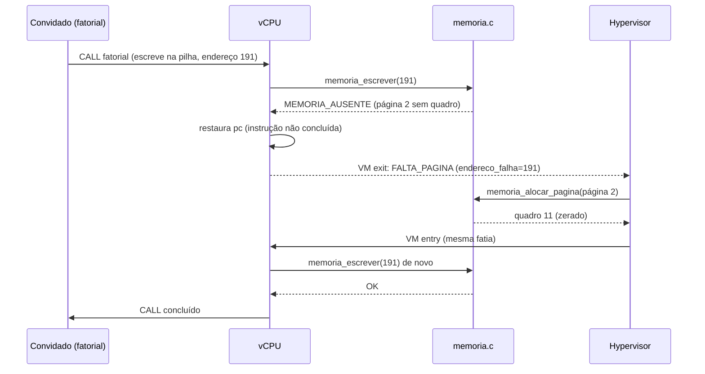
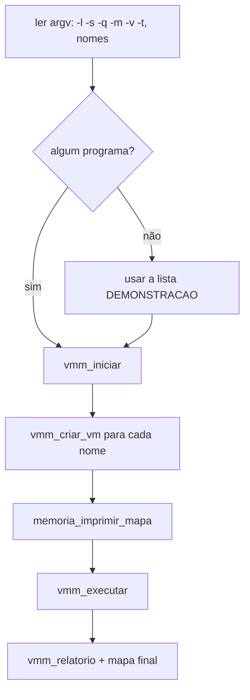

# Etapa 7 – Juntando tudo: o laço do hypervisor

**Arquivos:** `src/vmm.h`, `src/vmm.c` (`tratar_saida`, `encerrar_vm`, `tratar_falta_pagina`, `vmm_relatorio`), `src/main.c`

## Objetivo

Ligar todas as peças: o **tratador central de VM exits**, o **ciclo de vida** das VMs (criação e encerramento com devolução da memória), o **relatório** e o programa principal com a linha de comando.

## Conceitos da aula aplicados

- **Tratamento de exceções e interrupções**: um *dispatcher* central decide o que fazer com cada trap.
- **Isolamento de falhas**: o erro de uma VM encerra **só** aquela VM.
- **Liberação de recursos** ao fim de um processo.

## Passo 1 – O tratador de VM exits (`tratar_saida`)

Toda VM exit passa por esta função. Ela é o equivalente ao **vetor de interrupções** do SO:

```c
static void tratar_saida(struct MaquinaVirtual *vm, int motivo)
{
    vm->saidas[motivo]++;                    /* estatística */

    switch (motivo) {
    case SAIDA_QUANTUM:          vm->estado = VM_PRONTA;    break;  /* preempção     */
    case SAIDA_IO_OUT:           emular_out(vm);            break;  /* Etapa 4       */
    case SAIDA_IO_IN:            emular_in(vm);             break;  /* Etapa 4       */
    case SAIDA_HYPERCALL:        tratar_hypercall(vm);      break;  /* Etapa 4       */
    case SAIDA_FALTA_PAGINA:     tratar_falta_pagina(vm);   break;  /* Etapa 2       */
    case SAIDA_HLT:              encerrar_vm(vm, VM_FINALIZADA, "executou HLT"); break;
    case SAIDA_VIOLACAO_MEMORIA: /* ... */ encerrar_vm(vm, VM_ABORTADA, texto);  break;
    case SAIDA_INSTRUCAO_INVALIDA:/* ... */ encerrar_vm(vm, VM_ABORTADA, texto); break;
    case SAIDA_DIVISAO_ZERO:     /* ... */ encerrar_vm(vm, VM_ABORTADA, texto);  break;
    }
}
```

As saídas se dividem em três grupos:

| Grupo | Motivos | Depois do tratamento |
|---|---|---|
| **Emular e continuar** | `IO_OUT`, `IO_IN`, `HYPERCALL 0`, `FALTA_PAGINA` | a VM segue EXECUTANDO, retomando no mesmo quantum |
| **Escalonamento** | `QUANTUM`, `HYPERCALL 1/2` | a VM vai para PRONTA ou BLOQUEADA |
| **Fim** | `HLT` e erros | FINALIZADA ou ABORTADA, e a memória é liberada |

## Passo 2 – Falta de página

```c
static void tratar_falta_pagina(struct MaquinaVirtual *vm)
{
    int pagina = vm->cpu.endereco_falha / TAM_PAGINA;
    int quadro = memoria_alocar_pagina(&vm->paginas, pagina, vm->id);

    if (quadro == SEM_QUADRO) {          /* RAM do hospedeiro acabou */
        encerrar_vm(vm, VM_ABORTADA, "sem memoria no hospedeiro ...");
        return;
    }
    /* nada mais: o pc não avançou, a instrução será repetida */
}
```

A sequência completa de uma falta de página:



## Passo 3 – Encerramento e devolução de recursos

```c
static void encerrar_vm(struct MaquinaVirtual *vm, int estado_final, const char *motivo)
{
    console_descarregar(vm);          /* imprime a linha pendente  */
    memoria_liberar(&vm->paginas);    /* devolve TODOS os quadros   */
    vm->estado = estado_final;
    strncpy(vm->motivo_fim, motivo, sizeof vm->motivo_fim - 1);
    printf("[VMM] t=%-6ld VM%d (%s) %s: %s\n", ...);
}
```

O mesmo caminho é usado para término normal e para erro. Por isso, ao final, o mapa de memória está **sempre** todo livre: `quadros livres: 64 de 64`.

## Passo 4 – O programa principal (`main.c`)



As opções são tratadas com `strcmp` num laço sobre `argv`. Não usamos `getopt`, para manter o código portável e fácil de ler. Números são convertidos com `strtol` e validados.

| Opção | Efeito |
|---|---|
| `-l` | lista os programas |
| `-s nome` | mostra o assembly do programa |
| `-q N` | quantum |
| `-m N` | limite do watchdog |
| `-v` | mostra cada VM exit, troca de contexto e despertar |
| `-t` | rastreia cada instrução (`pc` + desmontagem) |

## Passo 5 – Lendo a saída da demonstração

```
[VMM] VM3 criada: 'fatorial' - 77 palavras, espaco de 3 paginas (2 carregadas)   ← carregador
      tabela de paginas:  p0->q4  p1->q5  p2->ausente                            ← pilha sob demanda
...
[VMM] Iniciando 6 VM(s) | quantum = 25 instrucoes | watchdog = 100000 instrucoes
  [VM2 contador  ] 1                                                             ← console virtual
[VMM] t=52     VM3: falta de pagina no endereco 191 -> pagina 2 recebeu o quadro 11
  [VM4 dorminhoco] Rodada 1, relogio = 82                                        ← IN do relógio
  [VM5 invasor   ] Vou tentar escrever no endereco 3000...
[VMM] t=91     VM5 (invasor) ABORTADA: violacao de memoria no endereco 3000 (pc=12)  ← isolamento
  [VM6 guloso    ] Vou monopolizar a CPU com um laco infinito!
  [VM2 contador  ] 5                                                             ← o guloso NÃO travou
...
[VMM] t=100958 VM6 (guloso) ABORTADA: watchdog: atingiu o limite de 100000 instrucoes

VM  Nome        Estado      Instrucoes Fatias  E/S  HCALL F.Pag  Motivo do fim
1   ola         FINALIZADA         323     13    55     1     0  executou HLT
...
Relogio final: 100958 ticks | ocioso: 0 | trocas de contexto: 63 | VM exits: 4177
```

Repare que a linha do `ola` aparece **depois** de várias outras. Ela foi montada caractere a caractere em várias fatias de tempo, e o buffer do console só a imprime ao chegar o `'\n'`.

## Ponto de verificação

```bash
make
./build/hypervisor                         # demonstração completa
./build/hypervisor invasor contador        # o contador termina normalmente
./build/hypervisor -v fatorial | head -40  # veja FALTA_PAGINA e HYPERCALL
make test
```

## Para discutir em aula

1. Por que um erro do convidado vira `ABORTADA` em vez de derrubar o processo hypervisor? Compare com um *segfault* de processo no Linux.
2. Hypervisors reais às vezes **injetam** a exceção de volta no convidado (por exemplo, a divisão por zero), para que o SO convidado a trate. O que seria necessário para fazer isso aqui?
3. Por que `encerrar_vm` chama `console_descarregar` antes de liberar a memória?

⬅️ [Etapa 6](06-etapa-escalonador.md) · ➡️ [Etapa 8 – Executável sem instalação e GitHub](08-etapa-executavel.md)
